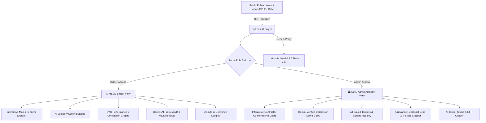

# 🔍 BidLens AI — Know Before You Bid

[](https://nodejs.org/)
[](https://ai.google.dev/)
[](https://react.dev/)
[](https://leafletjs.com/)
[](https://vercel.com/)
[](LICENSE)

> **BidLens AI** is an intelligent decision-support and procurement governance platform built to level the playing field for MSMEs in public procurement while providing government authorities with deep contractor verification, outcome analytics, and binding dispute redressal mechanisms.

---

## 🌟 Key Highlights & Architecture

BidLens AI bridges the critical gap between **Micro, Small & Medium Enterprises (MSMEs)** and **Government Procurement Authorities** (CPPP, GeM, Smart Cities, CPWD, NHAI, Railways, Municipal Bodies).



---

## 🚀 Features

### 🏢 1. MSME Bidder Portal
- **Interactive OpenStreetMap + Leaflet.js Tender Radar**:
  - Live geolocation map rendering tender opportunities across Indian states and municipalities.
  - Custom SVG map markers color-coded by industry sector (IT, Solar, Civil Infrastructure, Healthcare, Logistics).
  - Popup tender cards with estimated budgets, deadlines, EMD exemption indicators, and one-click drill-downs.
- **AI Eligibility & Matchmaking Engine**:
  - Compares vendor turnover, past performance certificates, and technical capabilities against RFP criteria.
  - Calculates a precise **Match Score (0–100%)** with granular breakdown across financial criteria, technical specs, and GFR regulatory compliance.
- **Contractor Analytics Dashboard**:
  - **SVG Past Tenders Performance Chart**: Visualizes awarded, in-progress, and historical bids across quarters.
  - **5-Pillar Profile Completeness Matrix**: Tracks Legal & KYC, Financial Statements, Technical Certifications, Past Work Orders, and Experience Certificates.
- **Gemini AI Diagnostic & Profile Attention Audit**:
  - Automated diagnostic scanner highlighting critical compliance gaps (e.g., expiring ISO certificates, working capital ratios).
  - Provides actionable, Gemini-generated recommendations to boost win rates.
- **Secure Document Vault**:
  - Manage and update GSTIN, Udyam, audited balance sheets, CA net worth certificates, and OEM authorisations.
  - **Interactive Vault Renewal Modal**: Seamless document update with validity dates and renewal tracking.
- **1-Click Bid Registration & Dispute Lodging**:
  - Rapid bid registration and seamless grievance lodging directly against contested tender specifications.

---

### 🏛️ 2. Government Authority & Procurement Dashboard
- **Dual-Role Authentication (`AuthModal`)**:
  - Dedicated access modes for **🏢 MSME Bidders** and **🏛️ Gov / Admin Officers**.
  - Officer sign-in and registration with Official Gov Email (`.gov.in`), Department (Smart City Development Ltd, CPWD, NHAI, Railways, Municipal Corp), Designation, and Employee Security ID.
- **Authority KPI Stat Banners**:
  - Live counters for Registered MSMEs, Issued Tenders / RFPs, Total Bids Submitted, and Open vs Resolved Grievances.
- **Contractor Intelligence Deck & Donut/Pie Chart (`CompanyPieChart`)**:
  - Clickable contractor deck to inspect any vendor's historical performance.
  - **Interactive SVG Donut / Pie Chart** breaking down tender outcomes:
    - 🟢 **Awarded & Completed** (Teal / `#0f766e`)
    - 🔵 **Active in Execution** (Blue / `#2563eb`)
    - 🟡 **Lost on Price L2/L3** (Amber / `#f59e0b`)
    - 🔴 **Technical Disqualification** (Red / `#ef4444`)
  - Hover micro-interactions with real-time percentage callouts and breakdown legend.
- **Gemini Verified Contractor Score (`getGeminiContractorScore`)**:
  - AI-audited contractor rating (0–100) and tier badges (`A+ Prime Tier`, `B- Flagged for Audit`, `F Debarred`).
  - Evaluates Milestone SLA Timeliness, Technical Compliance, Financial Solvency, and Dispute-Free Track Record.
  - Gemini AI commentary auditing GFR Rule 153/151 standing and CPPP/GeM historical records.
  - Direct administrative status changer (`Compliant`, `Flagged for Audit`, `Debarred / Blacklisted`).
- **All Issued Tenders Registry**:
  - Centralized table of all published public tenders, budgets, EMD values, deadlines, and live registered bidder counts.
  - Instant search filter and quick access to the AI Tender Studio.
- **Dispute Settlement & Grievance Redressal Desk**:
  - Centralized registry of all vendor disputes with urgency tags (`Critical`, `High`, `Medium`).
  - **4-Stage Visual Progress Stepper**: `Submitted` ➔ `Under Review` ➔ `Investigation` ➔ `Resolved`.
  - Officer stage updater with instant state synchronization to bidder views.
  - Official Directives Editor for recording binding administrative rulings.

---

### 🤖 3. Gemini AI Assistant & Tender Studio
- **Context-Aware Tender Copilot**: Floating interactive assistant aware of the active bidder profile, current tender document, and eligibility requirements.
- **AI Tender Studio**: Government officers can generate structured tender RFPs, scope definitions, and technical evaluation matrices using Gemini.

---

## 🛠️ Technology Stack

| Layer | Technologies |
|---|---|
| **Frontend** | HTML5, CSS3 Modern Custom Design System (HSL tokens, glassmorphism, responsive cards) |
| **Framework** | React 18 (Standalone UMD, zero build-step overhead), React Hooks |
| **3D & Visualization** | Three.js (dynamic icosahedron / octahedron hero scene), SVG Charts |
| **Geospatial Mapping** | Leaflet.js, OpenStreetMap (OSM) Tiles |
| **Backend Server** | Node.js native `node:http` (zero external dependencies) |
| **Serverless Deployment** | Vercel Serverless Function (`api/gemini.js`) |
| **AI Engine** | Google Gemini API (`gemini-3.5-flash` via HTTP streaming proxy) |

---

## 📁 Repository Structure

```text
BidLens-AI/
├── .env.example             # Template for environment variables
├── .gitignore               # Ignored files and directories
├── index.html               # Main single-file full-stack web application
├── server.js                # Local development Node.js server with Gemini proxy
├── Open BidLens.bat         # 1-Click launcher script for Windows
├── api/
│   └── gemini.js            # Vercel serverless function proxy for Gemini API
└── README.md                # Project documentation
```

---

## ⚡ Quick Start & Local Setup

### Prerequisites
- [Node.js](https://nodejs.org/) v18.0.0 or higher.
- A Google Gemini API Key ([Get an API Key here](https://aistudio.google.com/)).

### 1. Clone the Repository
```bash
git clone https://github.com/harshkumargupta016-a11y/BidLens-AI.git
cd BidLens-AI
```

### 2. Configure Environment Variables
Copy `.env.example` to `.env`:
```bash
cp .env.example .env
```
Open `.env` and insert your Gemini API Key:
```env
GEMINI_API_KEY=your_actual_gemini_api_key_here
GEMINI_MODEL=gemini-3.5-flash
PORT=3000
```

### 3. Launch the Application

#### Option A: Windows 1-Click Launcher
Double-click `Open BidLens.bat`. It will launch the Node server and open your default browser automatically.

#### Option B: Terminal Command
```bash
node server.js
```
Open your browser at:
```
http://localhost:3000
```

---

## 🔐 Demo Credentials

| Role | Username / Email | Password | Access Details |
|---|---|---|---|
| **MSME Bidder** | `harsh.kumargupta016@gmail.com` | Any password | Select company from dropdown (e.g. Apex Telematics, Bharat Infra, SolarVidyut) |
| **Gov / Admin Officer** | `officer@iscdl.gov.in` | Any password | Automatically opens the Government Procurement & Authority Dashboard |

---

## 🚀 Deployment to Vercel

BidLens AI is pre-configured for instant zero-config deployment on **Vercel**:

1. Push your repository to GitHub.
2. Import the project into your [Vercel Dashboard](https://vercel.com/new).
3. Under **Environment Variables**, add:
   - `GEMINI_API_KEY`: Your Google Gemini API Key.
   - `GEMINI_MODEL`: `gemini-3.5-flash` (optional, defaults to `gemini-3.5-flash`).
4. Click **Deploy**. The serverless function under `/api/gemini.js` will handle all AI requests securely.

---

## ⚖️ Disclaimer

*BidLens AI is an AI-powered procurement intelligence and decision-support tool. It does not provide formal legal advice or guarantee tender awards. Tenderers must independently verify all specifications, corrigenda, and eligibility criteria against official government tender documents.*

---

## 📄 License

This project is licensed under the [MIT License](LICENSE).
