# BidLens AI — Technology Stack & Architecture Reference

A comprehensive reference of all technologies, frameworks, libraries, database schemas, and AI models utilized across the **BidLens AI** platform across the **Frontend**, **Backend**, **Database**, and **AI / Rules Engine** layers.

---

## 1. High-Level Architecture

```mermaid
graph TD
    subgraph Client ["Frontend Client (Browser)"]
        UI["React 18 (UMD) + Vanilla CSS System"]
        MAP["Leaflet 1.9.4 (OpenStreetMap GIS)"]
        THREE["Three.js r128 (Canvas Visuals)"]
        SVG["Interactive SVG Charts (Bar & Donut)"]
        CONSOLE["Hidden Terminal Console (/get, /db, /sync)"]
        GATE["ProtectedGateScreen & Dual Auth Modal"]
    end

    subgraph Server ["Backend & Microservices"]
        FASTAPI["FastAPI 0.110 (Python 3.11)"]
        NODE["Node.js Local Proxy Gateway (server.js)"]
        ROUTERS["Domain Routers: Auth, Tenders, Bids, Grievances, AI-Score, Sync"]
        GEMINI["Google Gemini API (1.5 Flash / 2.0 Flash)"]
    end

    subgraph Storage ["Database & Persistence Layer"]
        SUPABASE["Supabase PostgreSQL 15"]
        RLS["Row Level Security (RLS) Policies"]
        TABLES["msme_profiles | work_orders | vault_documents"]
        LOCAL["synced_database.json & 60-MSME Master CSV"]
    end

    UI -->|REST / JSON| FASTAPI
    UI -->|Direct / Proxy| NODE
    FASTAPI -->|supabase-py (Async)| SUPABASE
    FASTAPI -->|google-generativeai| GEMINI
    NODE -->|API Proxy| GEMINI
    SUPABASE --> TABLES
    TABLES --> RLS
    FASTAPI --> LOCAL
```

---

## 2. Frontend Layer

| Category | Technology / Library | Version / Source | Purpose & Usage |
| :--- | :--- | :--- | :--- |
| **Core View Framework** | [React](https://react.dev) | `18.3.1` (UMD CDN) | Standalone single-page UI architecture rendered via `React.createElement` (`h(...)` hyperscript pattern) with zero build overhead. |
| **DOM Engine** | [ReactDOM](https://react.dev) | `18.3.1` (UMD CDN) | Mounts application components, manages reconciliation, and handles concurrent state updates. |
| **Geospatial & GIS Mapping** | [Leaflet.js](https://leafletjs.com/) | `1.9.4` (CDN) | Interactive geographic map (`LeafletGISMap`) with OpenStreetMap tiles; renders MSME cluster pins, tender locations, and proximity radius rings across India (Indore, Bhopal, Dewas, Pithampur, etc.). |
| **3D & Canvas Graphics** | [Three.js](https://threejs.org/) | `r128` (CDN) | Ambient 3D canvas visuals, animated mesh particles, and interactive background accents. |
| **Styling & Theming** | Pure Vanilla CSS | Custom Design Token System | Centralized CSS custom properties (`--bg`, `--sf`, `--ink`, `--mu`, `--ac`, `--sa`, `--rd`, `--ok`, `--ln`, `--hero`, `--hero2`). Supports system dark mode (`prefers-color-scheme`) and manual toggle. |
| **Typography** | Google Fonts | `Bricolage Grotesque` & `Figtree` | Display typography for statutory headers, numerical metrics, and data tables. |
| **Data Visualizations** | Custom SVG Data Components | Native React SVG | - **`TenderPerformanceChart`**: Grouped bar chart comparing applied vs awarded contracts with an overlay cubic Bézier win-rate curve.<br>- **`ContractorTenderOutcomePieChart`**: Donut chart with interactive hover arcs displaying historical contract award outcomes. |
| **Access Control & Gating** | `ProtectedGateScreen` & `AuthModal` | Custom Built | Enforces strict authentication for both **MSME Bidder** and **Government Authority** views. |
| **In-Browser Terminal** | `DataConsoleModal` | Custom Built | In-browser command terminal triggered via `/get`, `/db`, `/sync`, `/export`, or backtick (`` ` ``) key for real-time state inspection and database synchronization. |

---

## 3. Backend Layer

| Category | Technology / Library | Version / Source | Purpose & Usage |
| :--- | :--- | :--- | :--- |
| **API Framework** | [FastAPI](https://fastapi.tiangolo.com/) | `>=0.110.0` (Python 3.11) | Asynchronous, high-throughput REST API with automatic OpenAPI / Swagger documentation (`/docs`, `/redoc`). |
| **ASGI Server** | [Uvicorn](https://www.uvicorn.org/) | `>=0.28.0` | Production ASGI web server running FastAPI worker processes. |
| **Database SDK** | [`supabase-py`](https://github.com/supabase/supabase-py) | `>=2.4.0` | Official client library for PostgreSQL queries, RPC execution, connection pooling, and health checks. |
| **Data Validation** | [Pydantic](https://docs.pydantic.dev/) & `pydantic-settings` | `>=2.6.0` | Strict type validation, environment variable management (`config.py`), and request/response schema modeling. |
| **AI / LLM SDK** | [`google-generativeai`](https://github.com/google-gemini/generative-ai-python) | `>=0.4.0` | Official Google Gemini API client powering 5-Pillar tender evaluation and contractor auditing. |
| **HTTP Client** | [`httpx`](https://www.python-httpx.org/) | `>=0.27.0` | Async HTTP requests for external microservice communication. |
| **Local Proxy Server** | Node.js HTTP Server (`server.js`) | Node.js built-in | Lightweight single-port dev server (`Open BidLens.bat`) with streaming `/api/gemini` reverse proxy handling timeouts and token limits. |

### Domain Routers (`bidlens-backend/routers/`)
1. **`routers/auth.py`**: Dual-role authentication (MSME Bidder & Gov Officer), profile normalization, JWT token generation, and CSV fallback loading.
2. **`routers/tenders.py`**: Tender catalog, statutory GFR 2017 eligibility calculation, and geospatial bounding-box queries.
3. **`routers/bids.py`**: 1-Click statutory bid submissions under GFR Rule 153(iii) with instant EMD exemption verification.
4. **`routers/complaints.py`**: Grievance redressal workflow (Logged -> Under Review -> Formal Ruling -> Corrigendum -> Resolved).
5. **`routers/ai_score.py`**: Gemini 5-Pillar tender feasibility scoring engine.
6. **`routers/sync.py`**: Bidirectional synchronization linking frontend memory to persistent PostgreSQL storage.

---

## 4. Database & Storage Layer

| Component | Technology | Implementation Details |
| :--- | :--- | :--- |
| **Primary Database** | **PostgreSQL (Supabase)** | Cloud-hosted relational PostgreSQL 15 database with automated indexing and connection pooling. |
| **Security & Isolation** | **Row Level Security (RLS)** | Enabled across all tables: public read access for demo seeds, service-role privileges for administrative and backend API operations. |
| **Normalized Schema** | SQL DDL (`database/migrations/`) | Normalizes flat enterprise data into 3 relational tables: `msme_profiles`, `work_orders`, and `vault_documents`. |
| **Master Seed Dataset** | `bidlens_ai_60_msme_companies_seed.csv` | 60 realistic Indian MSME vendor profiles across IT, Solar, Construction, and Medical sectors. |
| **Offline Fallback** | `synced_database.json` | Local file-based JSON store ensuring offline fallback capabilities when cloud databases are unreachable. |

### Relational Schema Design

```mermaid
erDiagram
    msme_profiles ||--o{ work_orders : "has past experience"
    msme_profiles ||--o{ vault_documents : "stores compliance certs"

    msme_profiles {
        text id PK "e.g. COMP-001"
        text legal_name
        text udyam_number UK
        text enterprise_category "Micro | Small | Medium"
        boolean mse_eligible
        text sector
        text city
        text state
        numeric avg_3yr_turnover_lakhs
        numeric net_worth_lakhs
        text ca_turnover_udin
        int profile_completeness_pct
    }

    work_orders {
        uuid id PK
        text company_id FK
        int work_order_num
        text client_name
        numeric value_lakhs
        int completion_year
    }

    vault_documents {
        uuid id PK
        text company_id FK
        text doc_type "UDYAM | GST | ISO_9001 | ANNEXURE_IV | TYPE_TEST | BALANCE_SHEET"
        text document_name
        text status "VALID | EXPIRED | MISSING | UPLOADED"
        date valid_until
        jsonb details
    }
```



---

## 5. AI & Statutory Rules Engine

1. **Google Gemini LLM (`gemini-1.5-flash` / `gemini-2.0-flash`)**:
   - **5-Pillar Feasibility Scoring**: Evaluates Financial capacity, Technical past experience, Regulatory compliance, Statutory eligibility under GFR 153, and Geospatial capability.
   - **Contractor Verification Audit (0–100)**: Evaluates corporate governance, past dispute history, and statutory standing.
   - **Discrepancy Spotter**: Scans tender specifications against company vault documents to flag expiring ISO certificates, turnover deficits, or missing affidavits.
2. **Statutory Rules Engine**:
   - Implements Public Procurement Policy for MSEs Order 2012.
   - General Financial Rules (GFR 2017) Rules 153, 161, and 173 (EMD waiver, tender fee exemption, and 25% mandatory procurement allocation).
